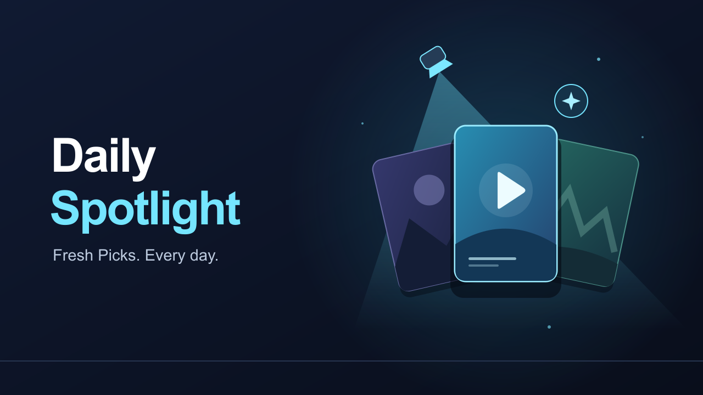

# DailySpotlight

<p align="center">
	
</p>

<p align="center">
	<a href="https://github.com/MFerretti27/DailySpotlight/actions/workflows/ci.yml">
		
	</a>
	<a href="https://github.com/MFerretti27/DailySpotlight/releases">
		
	</a>
</p>

Rediscover your Jellyfin library with a daily row of movie and series picks.

## What it does

- Shows a horizontally scrolling poster row on the legacy Jellyfin Web home tab, in an administrator-selected position.
- Chooses deterministic, shuffled picks for each user and calendar day.
- Resets at midnight in a configurable time zone (UTC by default).
- Supports movies, series, 1–50 picks, and an unwatched-only filter.
- Lets an administrator choose the Daily Spotlight row's position for everyone on the legacy Web home screen.
- Respects the signed-in user's accessible libraries and content restrictions.
- Opens the normal Jellyfin item detail page when a poster is selected.
- Includes dashboard settings, authenticated API, automatic legacy-Web script injection, tests, and ZIP packaging.

**Compatibility:** this initial version targets **Jellyfin Server 12.4 / .NET 10** and the **legacy Jellyfin Web home layout**. It does not target Jellyfin 10.10/10.11, the modern web layout, or native TV/mobile home screens. Installing a server plugin alone cannot add UI to every Jellyfin client.

## Screenhsots

<p align="center">

</p>


## Install the server plugin

Add this **URL** in **Dashboard → Plugins → Repositories → Add**:

```text
https://github.com/MFerretti27/DailySpotlight/releases/latest/download/manifest.json
```

Name the repository **DailySpotlight**, save, then open the **Catalog**, select **DailySpotlight**, install, and restart Jellyfin.

### Manual installation

1. Back up your Jellyfin configuration.
2. Stop Jellyfin.
3. Create a `DailySpotlight_<version>` folder inside **your Jellyfin data directory's `plugins` folder**, replacing `<version>` with the version in the downloaded ZIP, and extract the ZIP there. For the official Docker image, this is normally `/config/plugins/DailySpotlight_<version>/`.
4. Start Jellyfin.
5. Open **Dashboard → Plugins → Daily Spotlight** in the dashboard menu, configure the row, and save. The existing plugin details page also links to the same settings.

The server automatically injects the companion script into the legacy Jellyfin Web page and exposes `GET /DailySpotlight/Client.js` and authenticated `GET /DailySpotlight/Items` relative to its configured base URL. The latter requires a signed-in user token; administrator API keys are not a substitute for a user session.

## Home screen integration

After installing or updating the plugin, restart Jellyfin and reload the legacy Jellyfin Web page. The plugin injects its script into the served Web document; you do not need to edit `index.html` or reapply a script tag after Web updates. Administrators can choose the row's position for everyone in **Dashboard → Plugins → Daily Spotlight** settings. The plugin row cannot be added to Jellyfin's built-in **Home → Section Order** list. Use the shuffle button beside the row title to request a different set of picks for the current day; administrators can hide that button in plugin settings. The row appears only in the legacy Web home layout, not the modern web layout or native clients. Reverse proxies should preserve Jellyfin's base path when serving the Web page and plugin API.

To uninstall, stop Jellyfin, remove the plugin folder, and restart.

## Settings

| Setting | Default | Behavior |
| --- | --- | --- |
| Enabled | On | Disabling removes the row on its next refresh. |
| Title | Daily Spotlight | Heading displayed above the posters. |
| Item count | 20 | Clamped to 1–50 by the server. |
| Include movies / series | Both on | At least one must remain selected. |
| Unwatched only | Off | Uses Jellyfin's played state, including its series semantics. |
| Show shuffle button | On | Displays a button beside the row title so users can request a different selection. |
| Time zone | UTC | IANA ID such as `America/New_York`; invalid identifiers fall back to UTC. |
| Home row position | After My Media | Administrator setting applied to everyone. Can be placed at the top or after a supported Home section; if that section is not shown for a user, it falls back to after My Media. |
| Seed | DailySpotlight | Changing it changes the selection pattern and daily picks for all users. Use the shuffle button to get different picks for one user. Not a secret. |

Picks are stable **while the eligible library, watched state, user, and settings remain unchanged**, unless the user requests a shuffle. New media, removals, permission changes, or unwatched-state changes can also alter the row during the day. Consecutive days may contain some of the same titles; this is daily random discovery, not a no-repeat scheduler. Small libraries show fewer picks.

The web row refreshes when Home is shown, when the browser becomes visible, and roughly once per minute while visible. No plugin-specific recommendation database or scheduled task is needed. For correctness after permission changes, server requests re-query the eligible library rather than serving an all-day permission cache. This first version loads eligible candidates and sorts their hashes per request; very large libraries may need a later bounded-selection optimization.

## API

`GET /DailySpotlight/Items` returns a standard JSON envelope:

```json
{
	"Enabled": true,
	"Title": "Daily Spotlight",
	"Date": "2026-11-05",
	"Items": []
}
```

`Items` contains Jellyfin `BaseItemDto` objects. Identity comes from the authenticated `Jellyfin-UserId` claim, never a query parameter. Responses are marked `no-store`. The public JavaScript asset contains no tokens or library data; authenticated requests go through Jellyfin Web's `ApiClient.ajax` and do not persist credentials.

## Development and validation

```sh
dotnet test tests/DailySpotlight.Tests/DailySpotlight.Tests.csproj -c Release
npm ci
npm test
npm run check
```

VS Code build, test, and package tasks are included. CI runs the server, web, and release-manifest tests and uploads the plugin ZIP. `build.yaml` describes the release for Jellyfin's plugin build tooling; it is **not** a hosted plugin repository manifest. The release workflow generates the actual repository manifest from the uploaded archive's bytes.

### Build and test a release candidate locally

Run `npm run build:plugin` to install the Node test dependencies, run the .NET and web tests, build the plugin ZIP, and generate a manifest preview. The version is selected from local Git tags using the same next-version rule as the release workflow; pass `--version X.Y.Z` to build a specific release candidate. The command creates `artifacts/DailySpotlight_<version>.zip` and `artifacts/manifest.json`, but does not create or push a Git tag or publish a GitHub release. The manifest preview points to the future GitHub release URL, so install the ZIP manually to test it before publishing.

## Publish a GitHub Release

The **Publish Jellyfin plugin** workflow supports both automatic and direct-tag releases. To automatically choose the next version, commit and push the project and workflow, then open **Actions → Publish Jellyfin plugin → Run workflow** on the default branch. Leave the optional version override blank to increment the highest existing stable tag (starting at `v1.0.0`); the workflow pushes that tag and publishes the release in the same run. You can enter an explicit `X.Y.Z` version instead, but it must be greater than the latest existing version.

Alternatively, create and push a stable version tag directly:

```sh
git tag v1.0.0
git push origin v1.0.0
```

Use a new, increasing `vMAJOR.MINOR.PATCH` tag for each direct-tag release. Prerelease suffixes and four-component tags are rejected. The tag determines the assembly/package version even if the project file's development version has not changed. Never move a published tag or replace its ZIP: installed versions and checksums must remain trustworthy.

The workflow:

1. For a manually started release, chooses the next stable patch version (or validates the optional override), then pushes its tag. For a directly pushed tag, validates that tag.
2. Runs the .NET tests and the web/manifest tests.
3. Builds a ZIP containing only the versioned plugin assembly.
4. Generates `manifest.json` with a four-component plugin version, the Jellyfin package ABI, a tag-pinned ZIP download URL, and an **MD5** checksum as required by Jellyfin's installer.
5. Creates a draft GitHub Release and uploads the plugin ZIP, `manifest.json`, the standalone companion `dailyspotlight.js` (also embedded in the DLL), and the catalog banner `dailyspotlight.png`.
6. Adds installation instructions to the release notes, then publishes the release as **Latest** so the stable repository URL resolves.

The manifest's `imageUrl` points to that release's banner asset, allowing Jellyfin to show the artwork in its plugin catalog. Artwork is available in `assets/dailyspotlight.svg` (editable source) and `assets/dailyspotlight.png` (1280 × 720 release image). After changing the SVG, run `npm run artwork` and commit the updated PNG. The workflow uploads the committed PNG, which is validated by the test suite. Existing releases will not gain the image until a new version is published and Jellyfin refreshes the repository.

Only the release job receives `contents: write`; it uses GitHub's built-in `GITHUB_TOKEN`, with no personal access token required. Repository or organization policy must allow that token to create releases and push tags. Failed uploads leave a draft; rerunning the failed manually started workflow resumes that draft when it is for the same commit. Reruns refuse to replace assets on an already published release. If you manually create future releases, include a valid manifest asset or the `/releases/latest/download/manifest.json` URL can stop working.

The manifest advertises the latest release only, not a historical version catalog. The ZIP URL inside it is pinned to that release tag. Forks automatically use their own GitHub repository in generated manifests and release notes; update the installation URL above when documenting a fork.

To check manifest generation locally after packaging:

```sh
node scripts/create-manifest.mjs MFerretti27/DailySpotlight v1.0.0 artifacts/DailySpotlight_1.0.0.zip artifacts/manifest.json
```

The repository URL will not work until the first release workflow completes. Adding this URL does not publish anything by itself.

## Live validation

Open `tests/web/preview.html` in a browser for a mock home-screen preview with fictional media. It exercises the real companion script but does not connect to Jellyfin.

Automated coverage includes deterministic selection, input-order independence, uniqueness, count bounds, time zones/DST, automatic script injection into legacy Web HTML, base-path-aware script URLs, duplicate-injection prevention, safe DOM text rendering, authenticated requests, logout, and stale account-switch responses. These tests do **not** constitute a live Jellyfin server integration test.

Before deployment, test against a disposable Jellyfin 12.4 server with real libraries:

- Confirm the plugin loads without errors and settings survive a restart.
- Confirm the row is automatically injected on the legacy home tab and its posters open the correct items.
- Compare two accounts, including one with blocked libraries and parental restrictions.
- Confirm anonymous requests and API-key-only requests to the items endpoint are rejected.
- Verify unwatched filtering, empty libraries, disabled state, and missing artwork.
- Check a reverse-proxy base path, login/logout, navigation, and the daily reset.

No existing Jellyfin server or web installation was modified to create this project.
